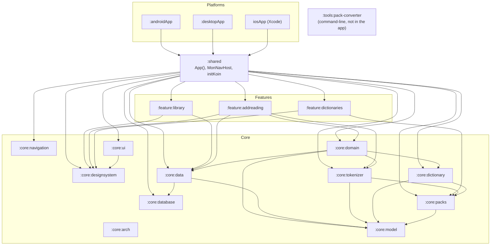
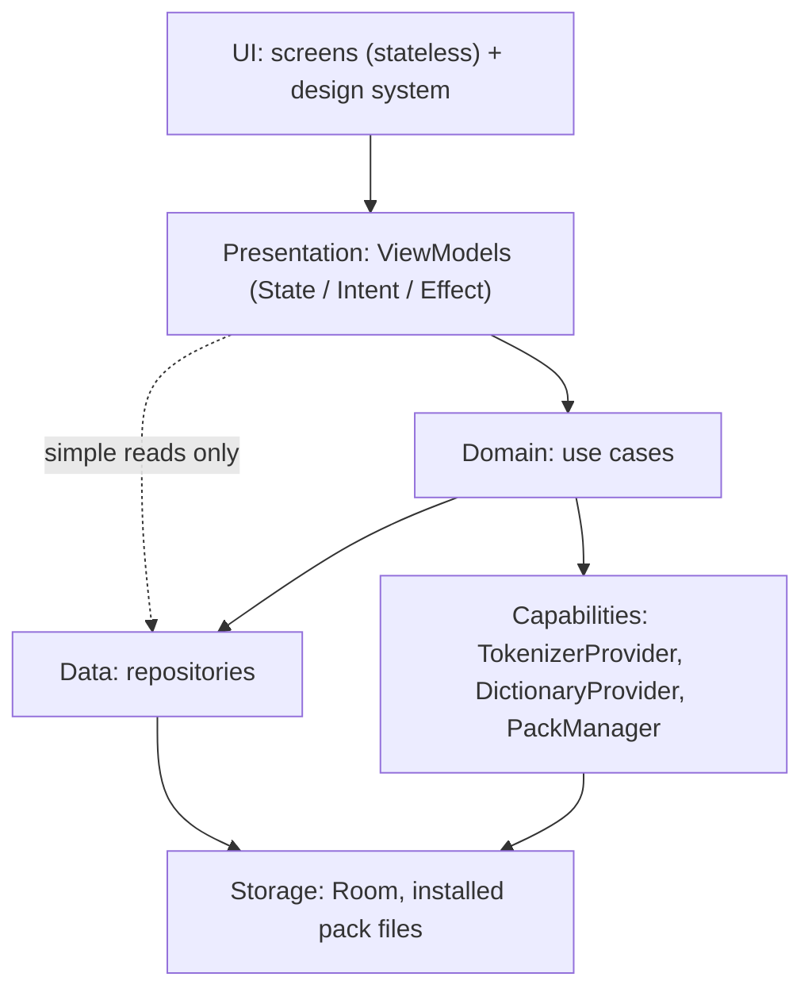
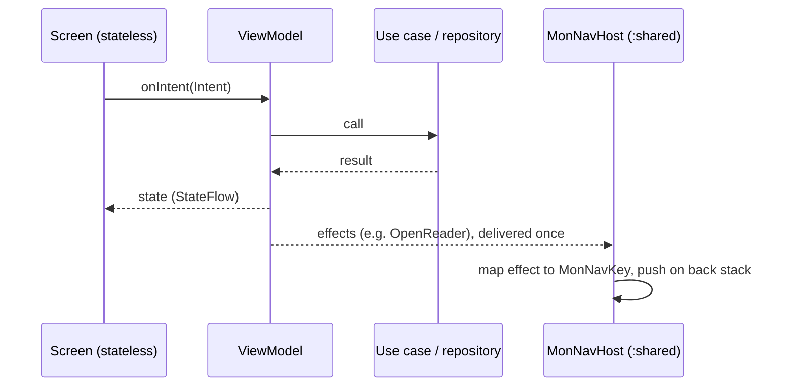
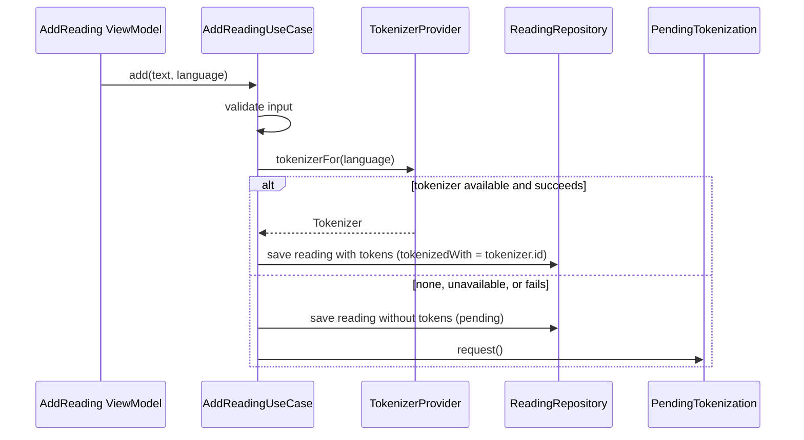
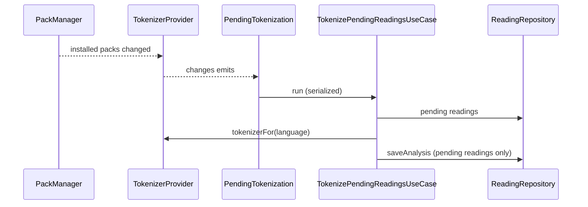
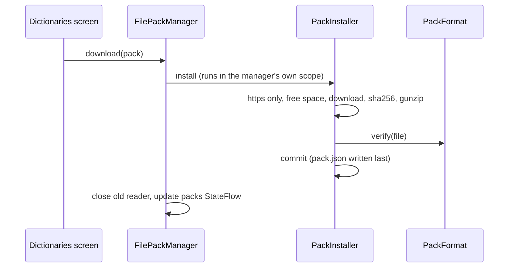

# Architecture

Overview of how Mon is built: the modules and their dependencies, the layers, the presentation
pattern, and the main runtime flows. For the dictionary and pack system in depth, see
[dictionary-architecture.md](dictionary-architecture.md); for build commands and gotchas, see
`AGENTS.md`. The module edges below come from the `build.gradle.kts` files; where this document and
the build scripts disagree, trust the scripts.

Mon is a reading/learning app. It shows readings with furigana and dictionary lookups, using a
Japanese tokenizer. It is a Kotlin Multiplatform project (Android, desktop, iOS) with Compose
Multiplatform UI, Room for persistence and Koin for dependency injection.

## Principles

- **Layered, one direction.** `:shared` depends on features and core modules; features depend on
  lower layers; nothing depends upward.
- **Capabilities, not implementations.** Code above `:core:tokenizer` and `:core:dictionary` asks a
  provider (`TokenizerProvider`, `DictionaryProvider`) and never assumes where a tokenizer or a
  dictionary comes from.
- **Downloadable packs.** Dictionaries and the Sudachi tokenizer dictionary are packs installed
  from a hosted catalog. The app works without any pack; Japanese readings are then stored
  *pending* (without tokens) and tokenized once a pack arrives.
- **Unidirectional presentation.** State flows down, intents flow up, one-off effects go through a
  channel.
- **Features are isolated.** A feature depends on neither `:core:database` nor another feature nor
  `:core:navigation`; `mon.feature` fails configuration if it does. `:shared` wires them together.

## 1. Modules

Every feature and the `:core:ui` module also use `:core:arch` and `:core:model` through the
convention plugins. Platform entry points only embed `:shared`.

| Module | Responsibility |
| --- | --- |
| `:shared` | The single `App()` composable, `MonNavHost`, the Koin bootstrap `initKoin`, Compose resources. |
| `:core:model` | Data models: `Reading`, `ReadingSummary`, `MonToken`, `Language`, `DictionaryEntry`, ... |
| `:core:domain` | Use cases: `AddReadingUseCase`, `TokenizePendingReadingsUseCase`, `LookupWordUseCase`, and `PendingTokenization`. |
| `:core:data` | Repositories (`ReadingRepository`, `UserRepository`); maps between Room entities and models. |
| `:core:database` | Room `MonDatabase`, DAOs, schemas and migrations (KSP codegen). |
| `:core:tokenizer` | `Tokenizer`, `TokenizerProvider`, and the Sudachi pack (`SudachiFormat`, `SudachiReader`). |
| `:core:dictionary` | `MonDictionary`, `DictionaryProvider`, the JMdict reader and `jmdict-sqlite` format. |
| `:core:packs` | The generic pack system: catalog, download, install, remove. Knows no file format. |
| `:core:ui` | Reusable content-aware Compose UI (kanji lookup screens, `VocabEntryItem`). |
| `:core:designsystem` | Theme, components, modifiers, generated icon catalog. No domain models. |
| `:core:navigation` | Navigation 3 keys (`MonNavKey`) and `MonNavConfiguration`. |
| `:core:arch` | `BaseViewModel<State, Intent, Effect>`. |
| `:feature:*` | Screens: library, add reading, dictionaries (pack management). |
| `:tools:pack-converter` | Turns dictionary source files into packs and writes the catalog. |

## 2. Layers and rules

- A feature may read through a repository directly for a simple query (the library list uses
  `ReadingRepository.observeReadingSummaries()`). Writes, and logic that combines repositories or
  the tokenizer, go through a use case.
- Screens and view models never touch `:core:database` or `:core:tokenizer` implementations.
- Lists use light summary models (`ReadingSummary`); the full `Reading` with tokens is loaded only
  for one reading (`getReading`).

## 3. Class diagram

Core types and their relationships. Implementations marked `internal` are not visible outside their
module.

```mermaid
classDiagram
  direction LR

  %% Presentation
  class BaseViewModel~State, Intent, Effect~ {
    <<abstract>>
    +state: StateFlow~State~
    +effects: Flow~Effect~
    #sendEffect(effect)
  }

  %% Domain
  class AddReadingUseCase
  class TokenizePendingReadingsUseCase
  class PendingTokenization {
    +request()
  }
  class LookupWordUseCase {
    +lookup(token) LookupResult
  }

  %% Data
  class ReadingRepository {
    <<interface>>
    +observeReadingSummaries()
    +getReading(id)
    +saveAnalysis()
  }
  class RoomReadingRepository
  class MonDatabase

  %% Tokenizer
  class Tokenizer {
    <<interface>>
    +language
    +id
    +tokenize(text) List~MonToken~
  }
  class TokenizerProvider {
    <<interface>>
    +tokenizerFor(language) Tokenizer?
    +changes: Flow~Unit~
  }
  class PackTokenizerProvider {
    <<internal>>
  }
  class SudachiReader {
    <<internal>>
  }
  class SudachiFormat

  %% Dictionary
  class MonDictionary {
    <<interface>>
    +lookup(query) List~DictionaryEntry~
  }
  class DictionaryProvider {
    <<interface>>
    +dictionariesFor(source, gloss) List~MonDictionary~
  }
  class PackDictionaryProvider {
    <<internal>>
  }
  class JmdictDictionary {
    <<internal>>
  }
  class JmdictFormat

  %% Packs
  class PackManager {
    <<interface>>
    +packs: StateFlow~List~Pack~~
    +readers() List~PackReader~
    +refreshCatalog() CatalogError?
  }
  class FilePackManager
  class PackInstaller
  class PackFormat {
    <<interface>>
    +open(pack) PackReader
    +verify(file)
  }
  class PackReader {
    <<interface>>
    +pack: CatalogPack
  }
  class CloseableReader {
    <<interface>>
  }

  BaseViewModel ..> AddReadingUseCase : feature VMs call
  BaseViewModel ..> ReadingRepository : simple reads

  AddReadingUseCase --> ReadingRepository
  AddReadingUseCase --> TokenizerProvider
  AddReadingUseCase ..> PendingTokenization : request()
  TokenizePendingReadingsUseCase --> ReadingRepository
  TokenizePendingReadingsUseCase --> TokenizerProvider
  PendingTokenization --> TokenizePendingReadingsUseCase
  PendingTokenization ..> TokenizerProvider : collects changes
  LookupWordUseCase --> DictionaryProvider

  ReadingRepository <|.. RoomReadingRepository
  RoomReadingRepository --> MonDatabase

  TokenizerProvider <|.. PackTokenizerProvider
  PackTokenizerProvider --> PackManager
  Tokenizer <|.. SudachiReader
  CloseableReader <|.. SudachiReader
  PackFormat <|.. SudachiFormat
  SudachiFormat ..> SudachiReader : opens

  DictionaryProvider <|.. PackDictionaryProvider
  PackDictionaryProvider --> PackManager
  MonDictionary <|.. JmdictDictionary
  CloseableReader <|.. JmdictDictionary
  PackFormat <|.. JmdictFormat
  JmdictFormat ..> JmdictDictionary : opens

  PackReader <|-- CloseableReader
  PackManager <|.. FilePackManager
  FilePackManager --> PackInstaller
  FilePackManager --> PackFormat : getAll registered
  PackManager ..> PackReader : readers()
```

Notes on the diagram:

- `Tokenizer` and `MonDictionary` are **capabilities**: interfaces that a reader implements *next
  to* `PackReader`; they do not extend it, so an online dictionary could implement
  `MonDictionary` too.
- A module that owns a format only registers it in Koin
  (`single { JmdictFormat } bind PackFormat::class`); `FilePackManager` collects every `PackFormat`
  with `getAll<PackFormat>()`, so the manager never changes for a new format.
- `PackTokenizerProvider` and `PackDictionaryProvider` retry a call when a reader was closed by an
  update or removal (`PackClosedException`), and throw `TokenizerUnavailableException` /
  `DictionaryUnavailableException` if the pack is gone.

## 4. Presentation and navigation

Each feature has a `*Contract.kt` (state, sealed intents, effects), a view model extending
`BaseViewModel`, and a stateless `Screen(state, onIntent)`.

- Intents are UI input, state is what is rendered, effects are one-off events. Effects are never
  signalled through state; a screen without effects uses `NoEffect`.
- View models expose typed errors (for example `LibraryError`), never exception messages; the
  screen maps them to string resources.
- Features do not depend on `:core:navigation`. `MonNavHost` collects their effects and maps them
  to `MonNavKey`s (`Library`, `AddReading`, `Dictionaries`, `Reader`). A new key must be registered
  in `MonNavConfiguration`, or back-stack restore crashes.
- The bottom bar is rendered by `MonNavHost` while a tab screen (`Library`, `Dictionaries`) is on
  top. Strings live in each feature's `composeResources`.

## 5. Runtime flows

### Adding a reading

### Tokenizing pending readings

`PendingTokenization` runs `TokenizePendingReadingsUseCase` once at start (from `initKoin`) and
again on every `TokenizerProvider.changes` emission, one run at a time. `saveAnalysis` only writes
to a reading that is still pending, so tokenizing the same reading twice is harmless.

### Looking up a word

`LookupWordUseCase` looks a `MonToken` up in every dictionary `DictionaryProvider` offers for the
language pair and returns `LookupResult`: `Found`, `NotFound`, or `NoDictionaryInstalled` (which the
UI turns into a "download a dictionary" prompt). The Reader's lookup sheet that will call it is not
built yet.

### Installing a pack

## 6. Persistence and data

- **Room** (`MonDatabase`) stores readings and their tokens. A reading records the id of the
  tokenizer that produced its tokens (`tokenizedWith`); `null` means pending. Schemas are exported
  to `core/database/schemas/`. Every version after 2 needs a `Migration`, covered by a test.
- **Pack files** live in `<base>/<packId>/dictionary.db` plus `pack.json`. The base is
  `noBackupFilesDir/dictionaries` on Android and `~/.mon/dictionaries` on desktop. The folder name
  is historical and must not change.
- **Catalog**: the app reads the `catalog.json` of the latest release of `mon-data` and offers only
  packs whose format, schema and languages it supports.

## 7. Dependency injection

Koin. Each module registers its own Koin module, and all of them are listed in `:shared`
(`Koin.kt`, `initKoin`); a new module must be added there. Platform differences are limited to
`expect`/`actual` Koin modules (`packsModule`, the Sudachi format registration) and the
`jvmAndAndroidMain` source set that holds the file, Ktor and SQLite code.

## 8. Extending the app

| To add | Do |
| --- | --- |
| A screen | A feature module with a contract, view model and screen; register its Koin module in `initKoin`; add a `MonNavKey`, register it in `MonNavConfiguration`, add an `entry<...>` in `MonNavHost`. |
| A word source or language | A `PackSource` in `:tools:pack-converter`, added to `SOURCES`; a new `Language` if needed. |
| A new kind of pack data | A format in its module, a capability interface extending `PackReader`, a provider that retries on `PackClosedException`, a use case, and the UI. |
| A database change | Update entities and the `MonDatabase` version, add a `Migration` and a migration test. |
