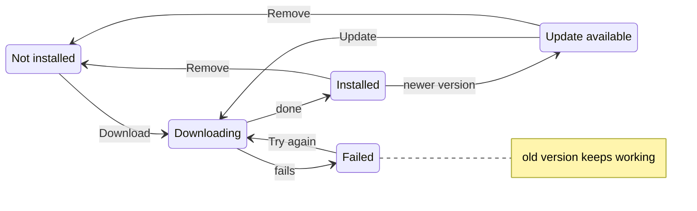

# Dictionaries screen — design spec for Claude Design

Nov 11, 2026 · @Alex

## What to design

Design the Dictionaries screen of Mon: the bottom-bar tab where a reader downloads, updates and removes dictionary packs. The screen works today but is unstyled scaffolding: a plain card per pack with text status and pill buttons. It needs a design that matches the existing Library, Import and Reader screens in `mon.penpot`.

In scope:

- The pack list and the pack card in each of its states.
- The screen-level states: first load, empty, offline or failed catalog check.
- Download progress, failure and retry.
- Remove, including whether it needs a confirmation.
- Where and how the licence attribution appears.
- The bottom-bar tab for this screen (icon and label).

Out of scope:

- The look-up sheet in the Reader and the Vocabulary screen. They are separate designs.
- New behaviour that needs new data, such as search inside a dictionary, pause and resume, or download queues. Section "Deliverables and open questions" lists the few places where a small behaviour change is acceptable.
- Changes to the colour palette or type scale. Use the existing tokens.

## Product context

Mon is a reading app for learners of Japanese. A reader imports a text, reads it with furigana above the kanji, and taps a word to look it up. It runs on Android and desktop from one Compose Multiplatform codebase, with iOS planned.

The app ships with no dictionary. Dictionaries are packs that the reader downloads on this screen, and the app is not tied to one dictionary or language pair. Today the catalog holds one pack, JMdict Japanese to English. More packs, for example Japanese to German, will follow, so design for a list of one to roughly ten.

Three facts shape the screen:

- **Reading works without a pack; look-up does not.** A reader who taps a word with no pack installed is told to download a dictionary. Many people will arrive here from that prompt, with one goal: get a dictionary and go back to reading.
- **Packs are large.** A pack is a download of tens of megabytes and takes more space once unpacked. Size and progress matter to the reader.
- **The screen must work offline.** Installed packs always show. Only the catalog check and downloads need a connection.

The screen is visited rarely: once to install, then occasionally to update. It should be calm and quick to scan, not a destination.

## Screen content

The screen is one scrolling list of packs under the title "Dictionaries", with the bottom bar below. Each pack carries the fields in this table. Nothing else is available without a code change.

| Field | Example | Shown today | Notes |
| --- | --- | --- | --- |
| Name | JMdict (English) | Yes, as the card title | Free text from the catalog. Allow two lines. |
| Version | 2026-11-02 | Yes, "Version 2026-11-02" | A date string for JMdict. Treat as opaque text. |
| Download size | 38 MB | Yes, in whole MB | The compressed download. |
| Unpacked size | 140 MB | No | Space used on the device once installed. Available to show. |
| Source language | ja | No | A language tag. Available to show as "Japanese". |
| Gloss language | en | No | Available to show as "English". |
| Attribution | Licence text, 1 to 3 sentences | Yes, at the foot of every card | Required by the licence. See "Licence attribution". |
| State | Installed | Yes, as text | See "States". |

Sizes in the table are illustrative. For a pack with an update available, the app also knows the installed version, so the card can show "installed 2026-10-05, new 2026-11-02".

The list has no sections, sorting or search today. With ten packs, grouping by language pair or putting installed packs first would help. Propose one if it earns its place.

## States

A pack card has seven variants and the screen has four states of its own. Each needs a frame.

### Pack card

| State | What the reader needs to see | Actions |
| --- | --- | --- |
| Not installed | Name, version, download size | Download (primary) |
| Downloading | Progress from 0 to 100%, as a bar or ring | None today |
| Installed | That it is installed and which version | Remove (secondary) |
| Update available | That the installed version still works and a newer one exists | Update (primary), Remove (secondary) |
| Failed, nothing installed | Why the download failed | Try again (primary) |
| Failed, old version still installed | Why the update failed, and that the old version still works | Try again (primary), Remove (secondary) |
| Failed with "unsupported" | That this app version cannot use the pack | Try again is offered today but cannot succeed. Propose a better treatment. |

Download, Update and Try again all lead to Downloading, and Remove returns a pack to Not installed. A failed update leaves the old version installed, so Remove is still offered there.

Progress covers the download only. Verifying and unpacking follow at 100% and take noticeable time on a phone, so the bar should not look finished and stuck. An indeterminate "Installing" phase would need a small code change and is acceptable.

There are five failure reasons, each with its own message: no connection, damaged download, could not save, not enough free space, unsupported. "Not enough free space" is the only one where the reader must act outside the app.

### Screen

| State | When | Today |
| --- | --- | --- |
| Checking | Every time the screen opens, while the catalog is fetched. Installed packs already show underneath. | A line of text and an indeterminate bar above the list |
| Loaded | The catalog check succeeded | The list, then a "Check again" button |
| Empty | The check succeeded and no pack fits this app version | "No dictionaries available." |
| Check failed | Offline, or the catalog could not be read. Installed packs still show and still work. | A red line of text above the list |

The most common first visit is "Checking" with an empty list, then one pack in "Not installed". The most common later visit is one pack in "Installed". Design those two first.

A failed check with packs installed is not an emergency: everything the reader has keeps working. It should read as a quiet notice, not an error page. A failed check with nothing installed is the one case that blocks the reader, and deserves a fuller empty state with a retry.

## Actions and flows

The screen has three actions: download a pack, remove a pack, and check the catalog again. Update and retry are the download action under another label.

- **Download, Update, Try again.** One tap starts it. The card moves to "Downloading" at once. There is no confirmation and no warning about mobile data today. Given the size, say whether a "download over mobile data?" check is worth adding. The download indicator should be an animation along the outline of the tile. The mon logo is reeling in a dictionary or pack on a fishing rod. The mon logo is available in the docs/design as PNG and SVG
- **Leaving the screen does not cancel a download.** The reader can switch to Library and keep reading. Coming back shows the current progress. Nothing outside this screen shows that a download is running. A badge on the tab icon would be a small addition if you think it is needed.
- **Cancel does not exist.** A download runs until it finishes or fails. If the design needs a cancel control, mark it as new behaviour.
- **Remove.** One tap deletes the pack immediately, with no confirmation and no undo. Getting it back means downloading it again. Decide between a confirmation dialog, an undo snackbar, or keeping it immediate, and show the chosen one.
- **Check again.** Re-fetches the catalog. It is a button at the end of the list today. Pull to refresh is not built, and would suit Android but not a mouse on desktop, so a visible control must remain.
- **Success.** When a download finishes, the card becomes "Installed". There is no toast or other feedback. For a reader who came from a failed look-up, consider a clear "ready" moment.

Each card tracks its own progress, so the design must hold up with more than one pack downloading.

## Licence attribution

Every pack's attribution text must be readable inside the app. This is a condition of the JMdict licence (CC BY-SA 4.0, © the Electronic Dictionary Research and Development Group), not a nicety.

The text comes from the catalog, differs per pack, and cannot be shortened or reworded. The JMdict one reads:

> This app uses the JMdict dictionary files. These files are the property of the Electronic Dictionary Research and Development Group, and are used in conformance with the Group's licence (https://www.edrdg.org/edrdg/licence.html), CC BY-SA 4.0. Converted with jmdict-simplified (https://github.com/scriptin/jmdict-simplified).

Today the full paragraph sits at the foot of every card, which makes the card long and gives legal text the same weight as the pack name. Rules for a better placement:

- It must be reachable from the pack it belongs to, in at most one tap, whether or not the pack is installed.
- It must be legible: at least Body Small (12 sp) with normal contrast. No 8 sp footnotes.
- It may be collapsed behind a "Licence" or "About this dictionary" row, a bottom sheet, or a detail screen.
- The two URLs should be tappable. They are plain text inside the string today.

A per-pack detail view could also hold the fields that do not fit on the card: unpacked size, languages and installed version.

## Design system constraints

Use the existing Mon tokens and components; the source of truth is `mon.penpot` and its handoff spec. A new component is fine where none fits, but no new colours or type sizes.

### Tokens

| Role | Token | Value |
| --- | --- | --- |
| Screen background | paper80 | #F7F2E8 |
| Top bar and bottom bar | paper90 | #FDFAF4 |
| Card and list row background | paper70 | #EDE7DA |
| Primary text | ink50 | #2B2723 |
| Secondary text, inactive icons | paper60 | #9A928A |
| Accent: primary buttons, progress, active icons | vermilion50 | #C0392B |
| Accent tint: active tab pill, selected chips | vermilion90 | #FDE3E3 |
| Secondary button, dark sheet | blue80 | #343449 |
| Error text | red70 | #BA1A1A |

- **Type.** Roboto Mono throughout. Screen title Headline Medium (28). Card title Title Small (14, weight 500). Body Medium (14) and Body Small (12) at weight 300. Labels at 12 and 10, weight 500.
- **Spacing.** A 4 dp base scale: 4, 8, 12, 16, 20, 24, 32, 40. Horizontal screen margin 39 dp. List rows sit 8 dp apart.
- **Shape.** Cards and list rows 12 dp corners. Buttons and chips fully rounded.
- **Icons.** Material Symbols, 24 dp, filled, weight 400. Any new icon must come from that set.

### Components to reuse

- **Scaffold with top bar.** The title sits in a paper90 bar. It accepts a leading icon and trailing actions, so "Check again" could move there as an icon.
- **Pill button.** Filled (vermilion50, white label) and Outline (transparent, secondary text label), with a disabled style and an optional sub-label.
- **Progress bar.** A thin vermilion bar in three weights, built for reading progress. Reuse it for downloads or specify a new variant.
- **Text list item.** The Library row: title, one line of meta, trailing chevron, 58 dp high. A pack row could follow it if detail moves to its own view.
- **Also available.** Section label, filter pill, dashed empty slot, icon button, bottom sheet.

### Bottom bar

The bar is 53 dp high on paper90 and holds two icon-only tabs: Library and Dictionaries. The active tab is a 36×26 pill in vermilion90 with a vermilion50 icon; inactive icons are paper60. The original Penpot file has a Vocabulary tab in the second slot, using the `dictionary` icon. Dictionaries takes that slot today, with its own icon in the app's icon catalog. Propose the icon, and assume Vocabulary may come back as a third tab that wants the book-like `dictionary` glyph.

### Known issues to avoid

- paper60 text on a paper70 card is below 4.5:1 contrast. Version, size and status sit exactly there today. Meet 4.5:1 for all text.
- red70 is defined but appears in no designed screen yet. This screen will set how errors look across the app, so keep it reusable.

## Platforms and layout

Design the Android phone first, at the 360×800 dp frame the other screens use, then show how it adapts to a desktop window. One layout serves both: the app is a single Compose Multiplatform UI, so platform-specific designs are not an option.

- **Android phone.** 360×800 dp, with a 20 dp status area, a 50 dp top bar and the 53 dp bottom bar. Touch targets at least 48 dp. The pill buttons are smaller than that today.
- **Desktop.** A resizable window, mouse and keyboard. At 39 dp margins a card stretches the full width of a wide window, which reads badly. Give a maximum content width or a column rule, and hover and focus states for the controls.
- **iOS.** Not built yet. No separate frames, but avoid patterns that only exist on Android.
- **Theme.** Light only. The palette has dark values defined but no dark theme is wired up. A dark variant is welcome and not required.
- **Long content.** A pack name of 40 characters, a failure message of two lines, and the attribution paragraph above must all fit without truncation.
- **Languages.** The UI is in English. Pack names may contain Japanese, so the name must render in a font with CJK glyphs.

## Copy

These are the strings in the app today. Keep them where they work and propose better wording where they do not; mark every change.

| Where | String |
| --- | --- |
| Title | Dictionaries |
| Checking | Checking for dictionaries… |
| Empty | No dictionaries available. |
| Refresh button | Check again |
| Card meta | Version 2026-11-02 · 38 MB (version and size are filled in) |
| Actions | Download · Update · Try again · Remove |
| Status | Installed · Downloading… · Update available |
| Catalog error, network | Could not check for dictionaries. Check your connection. |
| Catalog error, unreadable | The list of dictionaries could not be read. Please try again later. |
| Download error, network | The download failed. Check your connection. |
| Download error, damaged | The download was damaged. Please try again. |
| Download error, storage | The dictionary could not be saved on this device. |
| Download error, no space | There is not enough free space for this dictionary. |
| Download error, unsupported | This version of the app cannot use this dictionary. |

Copy that does not exist yet and the design will probably need:

- A first-run line that says why to download a dictionary: tapping a word in a text shows its meaning.
- A heading for the attribution on the detail screen, such as "Licence".
- Remove confirmation or undo text, if the design adds one.
- Wording for a failed update that says the installed version still works.
- How much space is needed, for the "not enough free space" case.

Tone: plain, short, no exclamation marks, no blame. British spelling ("licence").

## Deliverables and open questions

Deliver frames for every state above, plus a short spec in the format of the existing handoff spec so it can be built in Compose without guessing.

### Deliverables

1. Phone frames, 360×800 dp, light theme:
   - First visit: checking, then one pack not installed.
   - Downloading at about 40%.
   - Installed.
   - Update available.
   - Failed download with nothing installed, and failed update with the old version kept.
   - Catalog check failed with one pack installed, and with nothing installed.
   - Empty catalog.
   - A list of five packs in mixed states.
   - The attribution view, wherever it lives.
   - Remove confirmation or undo, if added.
2. One desktop frame at about 1200×800 showing the layout rule for wide windows.
3. The pack card as a component sheet: all seven variants side by side, with hover, pressed, focused and disabled states of its controls.
4. A handoff spec: tokens used per element, sizes and spacing in dp, type styles by name, icon names, and any new component with its parameters.
5. A list of every departure from this spec: new copy, new behaviour, new tokens.

### Open questions

Answer each in the design, with a one-line reason.

- [ ] Is a pack a card with inline actions, or a row that opens a detail view?

  Direction: each pack is a tile in a grid. Show the column count at 360 dp and on desktop, which actions sit on the tile, and what tapping the tile opens.
- [ ] Where does the attribution live, and what is its entry point called?

  Direction: on the detail screen that opens when the reader taps a tile, shown directly with no button or row to open it.
- [ ] Does Remove get a confirmation, an undo, or neither?

  Direction: a confirmation dialog. Show it with its copy, including the pack's size so the reader knows what re-downloading costs.
- [ ] Is "Check again" a button in the list, a top-bar icon, or both?

  Direction: a button in the list, not a top-bar icon.
- [ ] How is a failed catalog check shown when installed packs are still usable?
- [ ] What does the reader see between 100% downloaded and "Installed"?

  Direction: the 100% bar morphs into the "Installed" state.
- [ ] What replaces "Try again" for a pack this app version cannot use?

  Direction: no Try again button; a message that the pack is not compatible with this app version.
- [ ] Does a running download need to be visible outside this screen?

  Direction: not for now. No tab badge or other indicator outside this screen.
- [ ] Which icon does the Dictionaries tab use?

  Direction: the designer's choice, be creative. Keep to Material Symbols and leave the book-like `dictionary` glyph free for Vocabulary.

Acceptable small behaviour changes: an "Installing" phase after the download, a Remove confirmation or undo, tappable links in the attribution, and showing unpacked size and languages. Anything larger, such as cancel, pause or a download queue, should be flagged, not assumed.
