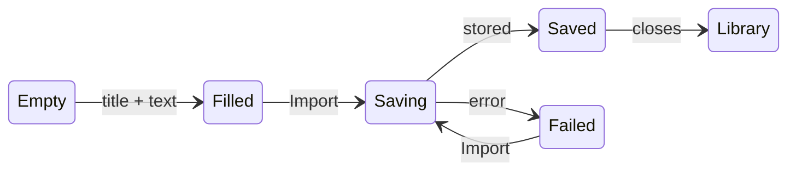

# Import screen — design spec for Claude Design

Nov 27, 2026 · @Alex

## What to design

Design the Import screen of Mon: the full-screen form where a reader adds a text to read. One frame exists (`docs/design/import/Import.png`, the empty screen). The code has more states than that frame shows, an "Add file" button with no behaviour, and a few open product questions. Design all of them so the screen can be rebuilt in Compose without guessing.

In scope:

- The screen in every state: empty, filled, focused, keyboard open, saving, error.
- The Add file flow and its errors.
- The source language: a choice, or fixed.
- The translation field: keep, move or drop it.
- What happens after a successful import.
- The desktop layout.

Out of scope:

- Reader, Library, Dictionaries and the Look up sheet. They are separate designs.
- OCR, import from a URL or the clipboard, EPUB and PDF. If the design needs one of these, flag it as new behaviour.
- Changes to the colour palette or type scale. Use the existing tokens.

## Product context

Mon is a reading app for learners of Japanese. A reader imports a text, reads it with furigana above the kanji, and taps a word to look it up. It runs on Android and desktop from one Compose Multiplatform codebase, with iOS planned.

Import is the only way to get text into Mon. It opens from the Library add button and closes with the X, back to Library. Four facts shape it:

- **Most imports are pasted.** The reader copies an article or a chapter from elsewhere. The paste area is the main control, which is why it fills the screen.
- **A reading is stored even when it cannot be analysed yet.** Furigana and look-up need a tokenizer pack. Without one the reading is stored as *pending* and is analysed once the pack is installed. Only a Japanese tokenizer exists today, so a reading in any other language stays pending. The reader should not feel the import failed.
- **Saving takes time on a long text.** Tokenizing runs before the reading is stored, so a long text keeps the screen busy for a noticeable moment on a phone.
- **Title and text are required.** Both are trimmed. The title is not guessed from the text.

## Screen content

| Field | Example | In the design | In the code | Notes |
| --- | --- | --- | --- | --- |
| Title | 吾輩は猫である | Yes, "Enter title..." | Yes | Required. Single line. |
| Text | A pasted chapter | Yes, the large area | Yes | Required. Multi-line, can be tens of thousands of characters. |
| Add file | | Yes, a small button | No | Behaviour does not exist. See "Add file flow". |
| Translation | An English translation | No | Yes ("Translation (optional)") | Stored, but shown nowhere in the app. The design omits it. |
| Source language | ja | No | Fixed to Japanese | No control today. `ja`, `en` and `de` exist as languages. |
| Translation language | en | No | Fixed to English | It is the gloss language for look-ups. No control today. |

## States

### Screen

| State | What the reader needs to see | Today |
| --- | --- | --- |
| Empty | The area, the title field and Import, which is disabled | One frame exists, but Import looks enabled |
| Text pasted, no title | That a title is missing | Import is disabled, with no explanation |
| Title and text filled | Import enabled | Not designed |
| Title focused | The focus ring on the title field | Not designed |
| Text focused, keyboard open | The caret in the area, and where Import sits | Not designed |
| Long text | The area scrolls inside itself | Not designed |
| Saving | That the import is in progress | The label changes to "Saving…" |
| Missing title or text | Which one | Text line above the button, which is not designed |
| Save failed | That nothing was saved, and what to do | Text line above the button, which is not designed |
| Saved | That the text is in the library | The screen closes and Library shows the new row. There is no other feedback. |

The error line should read as a quiet notice, not an alarm. Pick one error style that the Dictionaries design can share; red70 is defined but appears in no designed screen yet.

### Keyboard

On a phone the keyboard covers the bottom of the screen. Show where the title field and the Import button sit with the keyboard open, and whether the paste area shrinks or the whole form scrolls. On desktop there is no on-screen keyboard.

## Add file flow

Everything in this section is new behaviour. Do not assume it exists. The code has no file picker today, so any part that needs one for Android, desktop and iOS is a cost: say which parts are worth it.

- **Entry.** The Add file button opens the system file picker.
- **Types.** Propose which types to accept. Plain text (`.txt`) is the cheapest. Say whether anything else is worth it.
- **Reading.** A short loading state between choosing a file and the text appearing.
- **Result.** The text fills the area. Say whether the file name becomes the title and whether it replaces a title the reader typed.
- **Existing text.** If the area already has text, choosing a file either replaces it or appends to it. Pick one and show the confirmation, if any.
- **Errors.** Unsupported type, unreadable encoding, empty file, file too large. One message each, in the same style as the other errors.

## Actions and flows

- **Import.** Disabled until title and text are both non-blank. One tap starts it. The reader cannot leave a useful state while saving: show whether Import and the fields are locked.
- **Close (X).** Closes at once, and any typed text is lost. Decide between leaving as is, a discard confirmation, or keeping a draft, and show the chosen one.
- **Add file.** See above.
- **After Import.** Today the screen closes and Library shows the new row. Say whether it should instead open the new text in the Reader, and whether a "ready" moment is needed for a text that is still pending.
- **Pending imports.** If the text is stored without tokens, the Reader explains it. Say whether Import should warn the reader before they leave.
- **Language.** If the source language gets a control, show it, its default and where it sits. If it stays fixed, say so.

## Design system constraints

Use the existing Mon tokens and components; the source of truth is `mon.penpot` and its handoff spec. A new component is fine where none fits, but no new colours or type sizes.

### Tokens

| Role | Token | Value |
| --- | --- | --- |
| Screen background | paper80 | #F7F2E8 |
| Top bar and bottom bar | paper90 | #FDFAF4 |
| Paste area | paper70 | #EDE7DA |
| Primary text | ink50 | #2B2723 |
| Placeholder | paper65 | #D4CDCD |
| Title field | white | #FFFFFF |
| Title field border | not tokenised | #DFDCDC |
| Import button, caret, focus | vermilion50 | #C0392B |
| Add file button | blue80 | #343449 |
| Error text | red70 | #BA1A1A |

- **Type.** Roboto Mono throughout. The top bar title and the Import label use Title Medium (18, weight 700). The title field and the area use Body Medium (14) or smaller, as designed. Pasted Japanese text must render in a font with CJK glyphs.
- **Spacing.** A 4 dp base scale. Horizontal screen margin 39 dp.
- **Shape.** The paste area has 25 dp corners, the Import button 16 dp, the title field about 12 dp, and the Add file button a small radius (about 4 dp). Buttons elsewhere are fully rounded; say whether Add file and Import should follow that.
- **Icons.** Material Symbols, 24 dp, filled, weight 400. The X is `close`. Any new icon must come from that set.

### Components to reuse

- **Scaffold with top bar.** A leading icon, a centred title, paper90.
- **Text field.** The white single-line field with a border and a focus ring.
- **Buttons.** A primary button and a secondary button (blue80). Both need an enabled, pressed, focused and disabled style.
- **Notice.** A card or inline text for messages. Reuse it for the errors if it fits.
- **Bottom bar.** Visible on this screen with the Library tab selected.

### Known issues to avoid

- The frame puts the paste area at about 39 dp from the left and the field and button at about 34 dp. Pick one margin.
- The title field's border in the frame is `#DFDCDC`, which is not a token. The code uses a `Grey` of `#CCCCCC`. Pick one and tokenise it.
- The placeholder (paper65 on white) is below 4.5:1 contrast. Meet 4.5:1 for all text the reader needs.
- The Add file button is about 20 dp high. Touch targets must be at least 48 dp: enlarge the touch area, even if the button stays small.
- The Import button looks enabled in the frame while both fields are empty. Show a disabled style.

## Platforms and layout

Design the Android phone first, at the 360×800 dp frame the other screens use, then show how it adapts to a desktop window. One layout serves both: the app is a single Compose Multiplatform UI.

- **Android phone.** 360×800 dp, with a 20 dp status area, a 50 dp top bar and the 53 dp bottom bar.
- **Desktop.** A resizable window, mouse and keyboard. At 39 dp margins the paste area stretches the full width of a wide window, which reads badly. Give a maximum content width and show hover and focus states for the controls. Pasting with a shortcut is the common path.
- **iOS.** Not built yet. No separate frames, but avoid patterns that only exist on Android.
- **Theme.** Light only.
- **Long content.** A title of 60 characters and an error of two lines must fit without truncation.

## Copy

These are the strings in the app today, and the strings in the frame. Keep what works and propose better wording where it does not; mark every change.

| Where | In the app today | In the frame |
| --- | --- | --- |
| Top bar title | Add reading | Import text |
| Title field | Title | Enter title... |
| Paste area | Text | (empty, no placeholder) |
| Translation field | Translation (optional) | (none) |
| Button | Save | Import |
| Button while saving | Saving… | (none) |
| Add file | (none) | Add file |
| Error, no title | Enter a title. | (none) |
| Error, no text | Enter the text to read. | (none) |
| Error, save failed | Could not save the reading. Try again. | (none) |

Copy that does not exist yet and the design will probably need:

- A placeholder for the paste area that says what to do: paste or type a text.
- The Add file errors: unsupported type, unreadable, empty, too large.
- A discard confirmation, if the design adds one.
- A language label, if the source language gets a control.
- A line for a text that will be analysed later, if the design adds one.

Tone: plain, short, no exclamation marks, no blame. British spelling.

## Deliverables and open questions

Deliver frames for every state above, plus a short spec in the format of the existing handoff spec so it can be built in Compose without guessing.

### Deliverables

1. Phone frames, 360×800 dp, light theme:
   - Empty, and with Import disabled.
   - Text pasted without a title.
   - Title and text filled, with Import enabled.
   - Title focused, and text focused with the keyboard open.
   - A long text in the area.
   - Saving.
   - Each error: missing title, missing text, save failed.
   - The Add file flow: loading, the result, and each error.
   - The discard confirmation, if added.
   - The source language control, if added.
2. One desktop frame at about 1200×800 showing the layout rule for wide windows.
3. A component sheet: the paste area, the title field, the Add file button and the Import button, each with hover, pressed, focused and disabled states.
4. A handoff spec: tokens used per element, sizes and spacing in dp, type styles by name, icon names, and any new component with its parameters.
5. A list of every departure from this spec: new copy, new behaviour, new tokens.

### Open questions

Answer each in the design, with a one-line reason.

- [ ] Does the translation field stay, move or go?

  Direction:
- [ ] Is the source language a picker, detected from the text, or fixed to Japanese?

  Direction:
- [ ] Which file types does Add file accept?

  Direction:
- [ ] Does the file name become the title, and does it replace a title already typed?

  Direction:
- [ ] Does choosing a file replace or append to text already in the area?

  Direction:
- [ ] Does closing with typed text need a confirmation?

  Direction:
- [ ] After Import: back to Library, or straight into the Reader?

  Direction:
- [ ] How is a text that cannot be analysed yet explained at import time, if at all?

  Direction:
- [ ] Where does the Import button sit with the keyboard open?

  Direction:
- [ ] Is there a text length limit, and what is shown at it?

  Direction:
- [ ] How are errors shown, so the Dictionaries screen can share the style?

  Direction:

Acceptable small behaviour changes: dropping the translation field, importing `.txt` files, taking the title from the file name, a discard confirmation, opening the Reader after Import, and a language control. Anything larger, such as OCR, URL import, EPUB or PDF, or language detection, should be flagged, not assumed.
