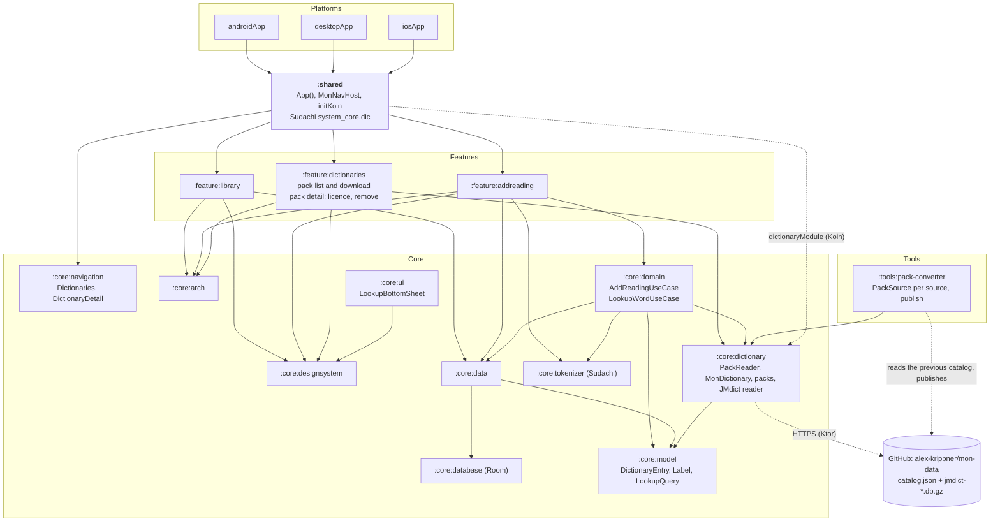

# Dictionary architecture

How the dictionary feature fits into the app. Everything drawn in the class diagram exists in the
code; the only part not built is the Reader's lookup sheet, which will call `LookupWordUseCase`.
`LookupBottomSheet` already exists in `:core:ui`, but nothing calls the use case yet. The module
edges are the real dependencies from the `build.gradle.kts` files and the `mon.feature` plugin.

Design decisions:

- The app is tied to no dictionary and no language. `MonDictionary` is an interface; entries are
  data classes; labels are a sealed hierarchy.
- The app is tied to no kind of data either. Every installed pack opens into a `PackReader`, and
  what a reader can answer is a capability on top of it. `MonDictionary` (word lookup) is the only
  capability today; a kanji or example-sentence pack would add its own.
- JMdict is the first dictionary, published as one pack per gloss language (English and German).
  Its file format, `jmdict-sqlite`, is the word-list format for any source and language pair.
- The converter is one tool with a subcommand per source. Packaging and the catalog are shared, and
  each run merges its packs into the catalog of the previous release.
- Dictionaries are downloadable packs listed in a hosted `catalog.json`, not bundled. The app works
  without any pack.
- `system_core.dic` (Sudachi) stays bundled.

## 1. Modules

The module rule still holds: features never depend on `:core:database` or on each other.
`:feature:dictionaries` talks to the `DictionaryManager` interface directly and does not use
`:core:domain`. No feature uses `:core:ui` yet; the lookup sheet in it waits for the Reader. `:shared`
wires everything together.

## 2. Classes

The stereotype names the visibility and, for classes outside `:core:dictionary`, the module.

```mermaid
classDiagram
  direction LR

  %% ---------- :core:dictionary commonMain (public contract) ----------
  class PackReader {
    <<interface>>
    +source: DictionarySource
    +sourceLanguage: Language
    +glossLanguage: Language
  }
  class MonDictionary {
    <<interface>>
    +lookup(query: LookupQuery) List~DictionaryEntry~
  }
  class DictionaryClosedException {
    <<exception>>
  }
  class CloseableReader {
    <<internal interface>>
    +close()
  }
  class DictionaryManager {
    <<interface>>
    +packs: StateFlow~List~Pack~~
    +refreshCatalog() CatalogError?
    +install(packId)
    +remove(packId)
    +readers() List~PackReader~
  }
  class installedExt["DictionaryManager.installed()"] {
    <<extension>>
    readers().filterIsInstance~MonDictionary~()
  }
  class Pack {
    <<data>>
    +info: CatalogPack
    +state: PackState
  }
  class PackState {
    <<sealed>>
    NotInstalled
    Downloading(progress, installed)
    Installed
    UpdateAvailable(installed)
    Failed(error, installed)
  }
  note for PackState "Failed covers a failed download or a failed removal"
  class CatalogPack {
    <<data, serializable>>
    id, name, format, schema
    sourceLanguage, glossLanguage
    version, url, sha256
    sizeBytes, unpackedSizeBytes
    attribution
  }
  class Catalog {
    <<serializable>>
    +packs: List~CatalogPack~
  }
  class PackError {
    <<enum>>
    NETWORK
    CHECKSUM
    STORAGE
    UNSUPPORTED
    NOT_ENOUGH_SPACE
    REMOVE
  }
  class CatalogError {
    <<enum>>
    NETWORK
    INVALID
  }

  %% ---------- :core:model ----------
  class DictionaryEntry {
    <<data :core:model>>
    id, source, headwords
    senses, labels
  }
  class DictionarySource {
    <<data :core:model>>
    id, name, attribution, version
  }
  class Headword {
    <<data :core:model>>
    text, reading
  }
  class Sense {
    <<data :core:model>>
    glosses, labels
  }
  class Label {
    <<sealed :core:model>>
    PartOfSpeech, Gender, Register
    Domain, Frequency, Other
  }
  class LookupQuery {
    <<data :core:model>>
    lemma, surface, reading
  }

  %% ---------- :core:dictionary jvmAndAndroidMain: packs ----------
  class FileDictionaryManager {
    <<internal>>
    -current: State
    -files: Mutex
    -opened: Map~String, CloseableReader~
    -scope: CoroutineScope
    -catalogUrl: String
  }
  class State {
    <<private data>>
    catalog: List~CatalogPack~
    installed: Map~String, CatalogPack~?
    activity: Map~String, PackState~
    removing: Set~String~
    toPacks() List~Pack~
  }
  class DictionaryFactory {
    <<internal>>
    +formatOf(pack) DictionaryFormat?
  }
  class DictionaryFormat {
    <<internal interface>>
    +format: String
    +schema: Int
    +verify(file, pack) Boolean
    +open(file, pack) CloseableReader
  }
  class PackInstaller {
    <<internal>>
    -baseDir: File
    +download(pack, verify, onProgress) File
    +commit(pack, database)
    +remove(packId) Boolean
    +installedPacks() List~CatalogPack~
    +sweep()
    +databaseFile(packId) File
  }
  class PackDownloader {
    <<internal interface>>
    +fetchText(url) String
    +download(url, target, fallbackBytes, onProgress)
  }
  class KtorPackDownloader {
    <<internal>>
    -client: HttpClient
  }
  class PackException {
    <<internal exception>>
    +error: PackError
  }
  class Sha256 {
    <<public file>>
    +sha256Hex(file) String
  }

  %% ---------- :core:dictionary jvmAndAndroidMain: JMdict ----------
  class JmdictFormat {
    <<internal object>>
  }
  class JmdictDictionary {
    <<internal>>
    -path: String
    -mutex: Mutex
    -connection: SQLiteConnection?
    -normalization: KeyNormalization
    -closed: Boolean
  }
  class KeyNormalization {
    <<internal enum>>
    NONE
    NFC_LOWER
    +id: String?
    +apply(text) String
    +forLanguage(language)$
    +fromMeta(value)$
  }
  class EntryPayload {
    <<internal serializable>>
    headwords, senses, labels
  }
  class JmdictWriter {
    <<public>>
    JmdictWriter(path, sourceLanguage)
    +putMeta(key, value)
    +insert(record)
    +finish()
    +close()
  }
  class JmdictRecord {
    <<public>>
    id, common
    headwords, senses, labels
  }
  class JmdictSchema {
    <<public object>>
    FORMAT, VERSION
    CREATE (internal)
  }

  %% ---------- :core:domain ----------
  class LookupWordUseCase {
    <<public :core:domain>>
    +execute(token, source, gloss) LookupResult
  }
  class LookupResult {
    <<sealed :core:domain>>
    Found(entries)
    NotFound
    NoDictionaryInstalled
  }

  %% ---------- :feature:dictionaries ----------
  class DictionariesViewModel {
    <<public :feature:dictionaries>>
    +onIntent(intent)
  }
  class DictionariesState {
    <<data :feature:dictionaries>>
    packs: List~Pack~
    installedIds: Set~String~
    isRefreshing: Boolean
    refreshError: CatalogError?
    readyPackName: String?
    installed: List~Pack~
    available: List~Pack~
  }
  class PackDetailViewModel {
    <<public :feature:dictionaries>>
    -packId: String
    +onIntent(intent)
  }
  class PackDetailState {
    <<data :feature:dictionaries>>
    pack: Pack?
    confirmingRemove: Boolean
  }

  %% ---------- :tools:pack-converter ----------
  class PackSource {
    <<interface :tools:pack-converter>>
    +id: String
    +title: String
    +inputHelp: String
    +build(inputs, workDir) List~BuiltPack~
  }
  class BuiltPack {
    <<internal :tools:pack-converter>>
    id, name, version
    sourceLanguage, glossLanguage
    format, schema, attribution
    file, entries, skipped
  }
  class Publish {
    <<file :tools:pack-converter>>
    publish(source, built, outDir, repo, previous, allowDrop) Release
    readCatalog(text) Catalog
    requireValidVersion(version)
  }
  class PackResult {
    <<internal :tools:pack-converter>>
    pack: CatalogPack
    archive, entries, skipped
  }
  class Release {
    <<internal :tools:pack-converter>>
    tag, title, packs, catalog
    kept, dropped
  }
  class PreviousCatalog {
    <<file :tools:pack-converter>>
    latestCatalogUrl(repo) String
    fetchText(url) String
  }
  class Main {
    <<file :tools:pack-converter>>
    SOURCES: List~PackSource~
    main(args)
  }
  class JmdictSource {
    <<object :tools:pack-converter>>
    id = "jmdict"
  }
  class SimplifiedDictionary {
    <<serializable :tools:pack-converter>>
    version, dictDate, languages
    commonOnly, tags, words
  }

  %% ---------- inheritance ----------
  MonDictionary --|> PackReader
  CloseableReader --|> PackReader
  JmdictDictionary ..|> MonDictionary
  JmdictDictionary ..|> CloseableReader
  FileDictionaryManager ..|> DictionaryManager
  KtorPackDownloader ..|> PackDownloader
  JmdictFormat ..|> DictionaryFormat
  JmdictSource ..|> PackSource

  %% ---------- contract and model ----------
  DictionaryManager --> Pack
  DictionaryManager ..> CatalogError : refreshCatalog returns
  DictionaryManager ..> PackReader : readers returns
  installedExt ..> DictionaryManager : readers()
  installedExt ..> MonDictionary : keeps only
  Pack --> CatalogPack
  Pack --> PackState
  PackState --> PackError
  Catalog --> CatalogPack
  PackReader --> DictionarySource
  PackReader ..> DictionaryClosedException : any call throws
  MonDictionary ..> LookupQuery
  MonDictionary ..> DictionaryEntry
  DictionaryEntry --> DictionarySource
  DictionaryEntry --> Headword
  DictionaryEntry --> Sense
  DictionaryEntry --> Label
  Sense --> Label

  %% ---------- packs ----------
  FileDictionaryManager *-- State
  State --> CatalogPack
  State --> PackState
  FileDictionaryManager --> PackInstaller
  FileDictionaryManager --> PackDownloader : fetch catalog
  FileDictionaryManager --> DictionaryFactory
  FileDictionaryManager --> CloseableReader : keeps open readers of any kind
  DictionaryFactory --> DictionaryFormat
  PackInstaller --> PackDownloader
  PackInstaller ..> Sha256 : checks download
  PackInstaller ..> PackException : throws
  KtorPackDownloader ..> PackException : throws
  PackException --> PackError

  %% ---------- JMdict ----------
  JmdictFormat ..> JmdictDictionary : creates
  JmdictFormat ..> JmdictSchema
  JmdictFormat ..> KeyNormalization : verify rejects an unknown rule
  JmdictDictionary ..> EntryPayload : reads
  JmdictDictionary ..> KeyNormalization : reads the rule from the file
  JmdictWriter ..> KeyNormalization : picks the rule, writes it to the file
  JmdictWriter ..> EntryPayload : writes
  JmdictWriter ..> JmdictRecord
  JmdictWriter ..> JmdictSchema

  %% ---------- users ----------
  LookupWordUseCase --> installedExt
  LookupWordUseCase ..> LookupResult
  LookupWordUseCase ..> DictionaryClosedException : retries on
  LookupResult --> DictionaryEntry
  DictionariesViewModel --> DictionaryManager
  DictionariesViewModel --> DictionariesState
  DictionariesState --> Pack
  PackDetailViewModel --> DictionaryManager
  PackDetailViewModel --> PackDetailState
  PackDetailState --> Pack
  Main --> PackSource : picks by subcommand
  Main ..> PreviousCatalog : fetches the latest catalog
  Main ..> Publish
  PackSource ..> BuiltPack : builds
  Publish ..> BuiltPack : gzips and describes
  Publish ..> Release
  Release --> PackResult
  PackResult --> CatalogPack
  Publish ..> Sha256
  Publish ..> Catalog : merges the previous one, writes catalog.json
  JmdictSource ..> SimplifiedDictionary : parses
  JmdictSource ..> JmdictRecord : maps words to
  JmdictSource --> JmdictWriter
  JmdictSource ..> JmdictSchema
```

## How to read it

- **Boundary:** the public contract (`PackReader`, `MonDictionary`, `DictionaryManager`, `Pack`,
  `PackState`, `CatalogPack`) is in `commonMain` and has no `java.*`, which keeps iOS and web open.
  `PackInstaller`, `PackDownloader`, `JmdictDictionary` and the other classes that use
  `java.io.File` stay in `jvmAndAndroidMain`.
- **Ktor seam:** only `KtorPackDownloader` knows Ktor. Replacing it (for example with WorkManager)
  touches that one class.
- **Capability seam:** the manager hands out `PackReader`s and knows nothing about what they can
  answer. `MonDictionary` is one capability, and `installed()` is the extension that picks it out
  of `readers()`. A new kind of data (kanji, example sentences) adds a capability interface, an
  extension like `installed()` and a use case; the manager, the installer and the Dictionaries
  screen stay as they are. `DictionaryManagerTest` proves this with a test-only pack kind.
- **Format seam:** `DictionaryFormat` and `DictionaryFactory` are the only link between a catalog
  `format` string and a reader. A new storage format adds one `DictionaryFormat` and no change to
  the manager. `open` must not touch the file, because `readers()` opens every installed pack.
- **Key normalization:** `jmdict-sqlite` serves any language pair. The writer picks a
  `KeyNormalization` from the source language and records it in the file's meta table; the reader
  applies what the file says and never looks at the language. Japanese files have no such row and
  are byte-identical to the ones published before the rule existed.
- **State:** `FileDictionaryManager` keeps one private `State` and derives `packs` from it on every
  change. `PackInstaller` keeps no state; it only does the file work.
- **UI path:** `LookupWordUseCase`, `DictionariesViewModel` and `PackDetailViewModel` depend only on
  the `DictionaryManager` interface. They never see files, Ktor or SQLite.
- **Converter:** `JmdictWriter`, `JmdictRecord`, `JmdictSchema` and `sha256Hex` are public only
  because `:tools:pack-converter` uses them; the app itself only reads.
- **Converter split:** a `PackSource` only turns its input files into uncompressed pack files
  (`BuiltPack`). `publish` does what is the same for every source: gzip, sha256, sizes, URL, the
  release tag and the catalog. A source owns the pack ids with its prefix (`jmdict-…`): `publish`
  takes the previous release's catalog, replaces that source's packs and keeps all others, because
  the app only reads the catalog of the latest release. A run that would drop one of the source's
  own published packs fails unless it is allowed explicitly. A new source is a new package plus
  one entry in `SOURCES`.
- **Rules and checklists** for adding a source, a format or a kind, and for the catalog and the
  releases, are in `AGENTS.md` under "Dictionary packs".
- **Not drawn:** the Reader's lookup sheet, which will call `LookupWordUseCase` (a follow-up).
  `LookupBottomSheet` exists in `:core:ui`, but nothing uses it yet.
