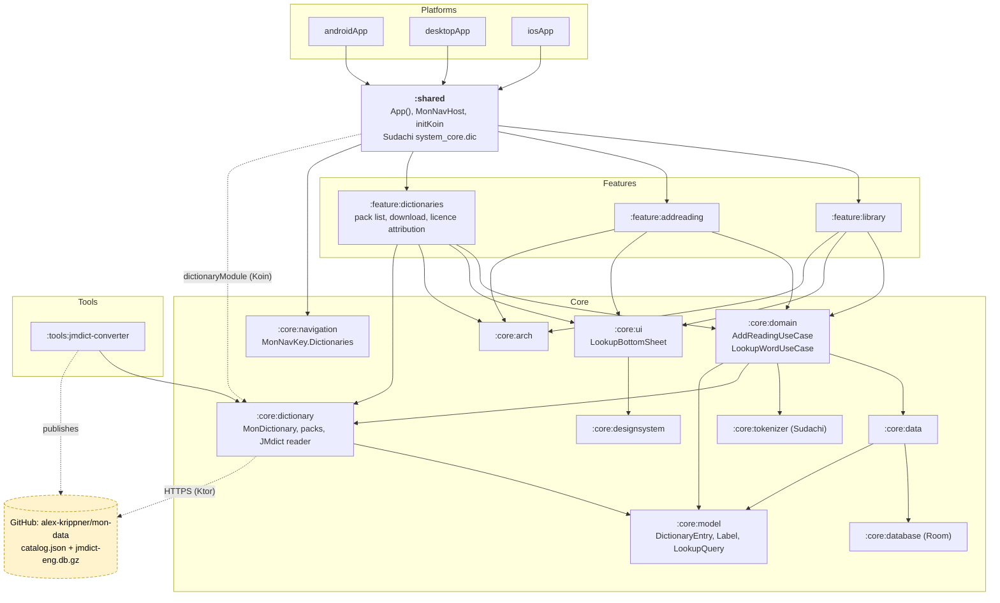
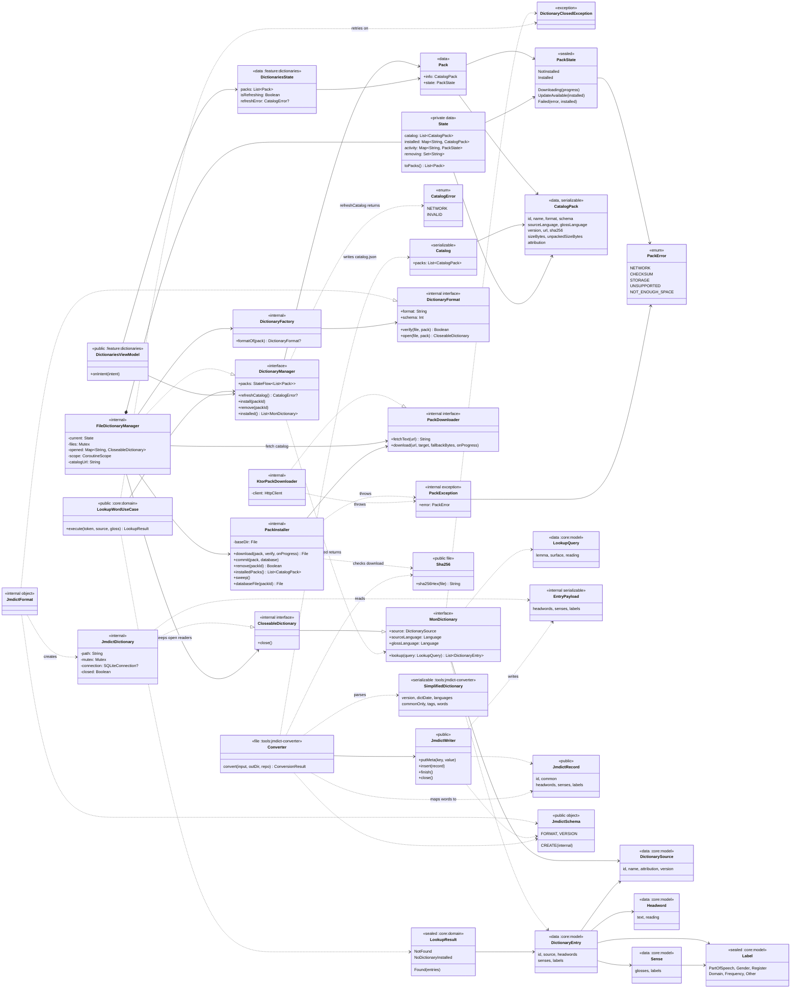

# Dictionary architecture

How the dictionary feature fits into the app. Everything drawn in the class diagram exists in the
code; the only planned part is the Reader's lookup sheet, which will call `LookupWordUseCase`. The
module edges are simplified from `AGENTS.md`.

Design decisions:

- The app is tied to no dictionary and no language. `MonDictionary` is an interface; entries are
  data classes; labels are a sealed hierarchy.
- JMdict (English glosses) is the first dictionary.
- Dictionaries are downloadable packs listed in a hosted `catalog.json`, not bundled. The app works
  without any pack.
- `system_core.dic` (Sudachi) stays bundled.

## 1. Modules

Yellow dashed boxes are planned.

The module rule still holds: features never depend on `:core:database` or on each other.
`:feature:dictionaries` reaches the dictionary only through `:core:domain` or the
`DictionaryManager` interface, and `:shared` wires them together.

## 2. Classes

The stereotype names the visibility and, for classes outside `:core:dictionary`, the module.

## How to read it

- **Boundary:** the public contract (`MonDictionary`, `DictionaryManager`, `Pack`, `PackState`,
  `CatalogPack`) is in `commonMain` and has no `java.*`, which keeps iOS and web open.
  `PackInstaller`, `PackDownloader`, `JmdictDictionary` and the other classes that use
  `java.io.File` stay in `jvmAndAndroidMain`.
- **Ktor seam:** only `KtorPackDownloader` knows Ktor. Replacing it (for example with WorkManager)
  touches that one class.
- **Format seam:** `DictionaryFormat` and `DictionaryFactory` are the only link between a catalog
  `format` string and a reader. A German dictionary adds one `DictionaryFormat` and no change to
  the manager.
- **State:** `FileDictionaryManager` keeps one private `State` and derives `packs` from it on every
  change. `PackInstaller` keeps no state; it only does the file work.
- **UI path:** `LookupWordUseCase` and `DictionariesViewModel` depend only on the
  `DictionaryManager` interface. They never see files, Ktor or SQLite.
- **Converter:** `JmdictWriter`, `JmdictRecord`, `JmdictSchema` and `sha256Hex` are public only
  because `:tools:jmdict-converter` uses them; the app itself only reads.
- **Not drawn:** the Reader's lookup sheet, which will call `LookupWordUseCase` (a follow-up).
